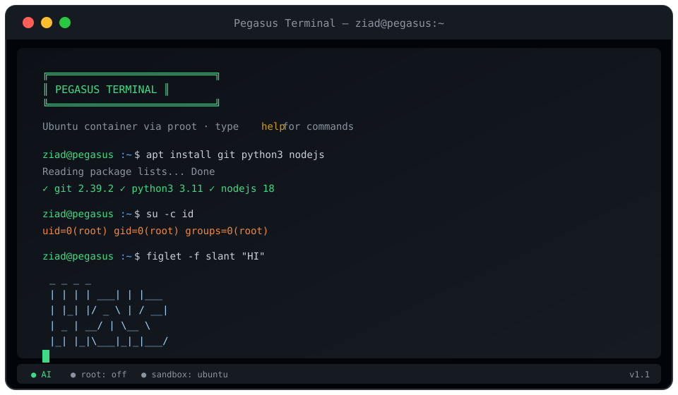

 

 

<table align="center">
  <tr>
    <td colspan="1" align="center" bgcolor="#1a1a2e" style="padding:10px 40px; border-top-left-radius:12px; border-top-right-radius:12px;">
      <b>PEGASUS-TERMINAL-DOTS</b>
    </td>
  </tr>
  <tr>
    <td align="center" bgcolor="#f5f0e1" style="padding:18px; border-bottom-left-radius:12px; border-bottom-right-radius:12px;">
      
    </td>
  </tr>
</table>

 

**Ziad** · `ziad-09` · he/him

**Android Engineer / Terminal Builder**

Building [**Pegasus Terminal**](https://github.com/ziad-09/pegasus-terminal) —
an Android terminal with AI chat, proot Ubuntu & real root.

 

 

**Made with ❤️**

